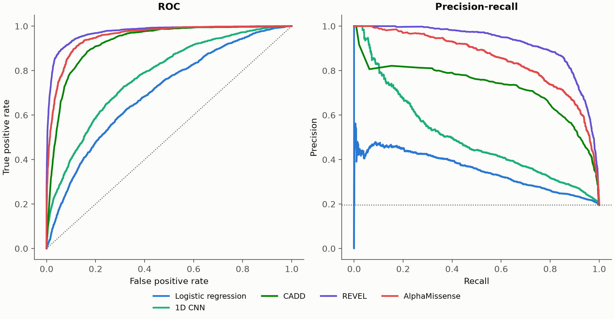
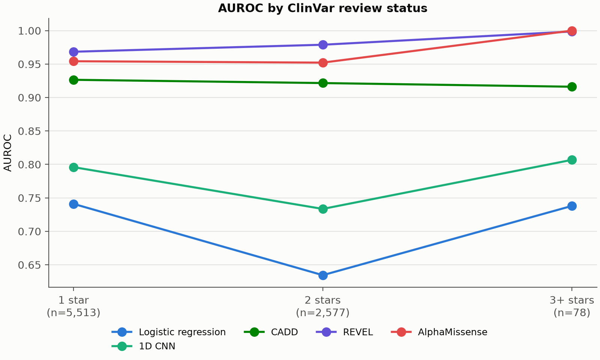
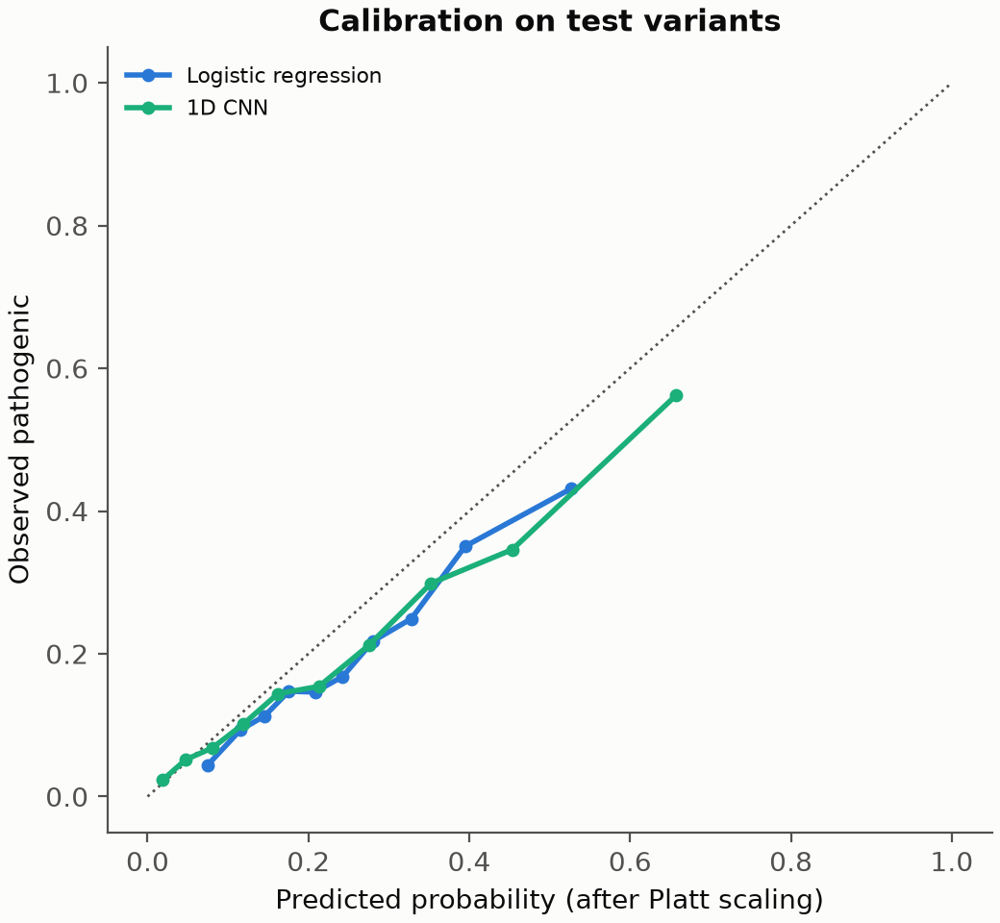

# DeepVariantEffect: Report

## Question

How well can a model separate pathogenic from benign missense variants using only the DNA
around them, compared with established tools that use conservation and protein features?

## Data

ClinVar missense SNVs with at least one review star, 1,025 bp windows from GRCh38, split by
chromosome: test on chr8 and chr21, validate on chr10, train on the rest. The split keeps
near-identical windows apart, but genes on test chromosomes can still have paralogs in training.

## Methods

Windows are on the genome's forward strand, while genes can lie on either strand, so all models
use strand handling: substitution classes are collapsed to one strand for logistic regression,
and the neural models train with reverse-complement augmentation and average both strands.

- **Logistic regression:** 96 trinucleotide substitution classes, context 4-mer frequencies
  and the 6-mers the variant creates or destroys.
- **1D CNN:** three convolutional blocks on one-hot ref and alt, over 201 bp.
- **NT + LoRA:** Nucleotide Transformer (24 layers, frozen) with trainable LoRA adapters on
  the query and value projections of each attention layer. The head reads the token holding
  the variant and the mean of all tokens, for ref and for alt minus ref.

Model selection used validation AUPRC only. Test variants were used once, for the numbers below.
CIs come from 500 bootstrap resamples of genes, because variants in one gene are correlated.
Probabilities were calibrated by Platt scaling on the validation set.

## Results

On the 8,168 of 8,677 test variants that have a score from every
external tool, so all rows use identical variants.

| Model | AUROC (95% CI) | AUPRC (95% CI) | Within-gene AUROC |
|---|:---:|:---:|:---:|
| REVEL | 0.973 (0.965-0.979) | 0.921 (0.885-0.948) | 0.953 |
| AlphaMissense | 0.954 (0.941-0.967) | 0.851 (0.789-0.903) | 0.959 |
| CADD | 0.926 (0.909-0.945) | 0.723 (0.634-0.809) | 0.912 |
| 1D CNN | 0.775 (0.745-0.804) | 0.497 (0.388-0.591) | 0.753 |
| Logistic regression | 0.701 (0.678-0.727) | 0.352 (0.277-0.440) | 0.676 |

- The best sequence-only model is 1D CNN, AUROC 0.775.
- Against REVEL the difference is -0.198 (95% CI -0.229 to -0.168, resampling genes).

### By review status

| Review status | n | Pathogenic | Logistic regression | 1D CNN | CADD | REVEL | AlphaMissense |
|---|---:|---:|:---:|:---:|:---:|:---:|:---:|
| 1 star | 5,513 | 937 | 0.741 | 0.796 | 0.926 | 0.968 | 0.954 |
| 2 stars | 2,577 | 615 | 0.634 | 0.733 | 0.922 | 0.979 | 0.952 |
| 3+ stars | 78 | 44 | 0.738 | 0.807 | 0.916 | 0.999 | 1.000 |

### Calibration

- Logistic regression: ECE 0.053
- 1D CNN: ECE 0.043

## Limitations

- CADD, REVEL and AlphaMissense may have been trained or tuned on variants that overlap this
  test set, so their scores here can be optimistic. This model's chromosome split is stricter.
- ClinVar labels are biased toward well-studied genes and European ancestry.
- Some "benign" labels partly reflect allele frequency, so a test on ClinVar is not a test
  on the variants of uncertain significance the tool would actually be used for.
- Missense annotation is by any transcript, so some pathogenic variants may act through
  splicing rather than the amino acid change.
- Not a clinical tool.

## Run details

- Logistic regression: `{"name": "logreg_kmer", "data": "data/processed/variants.parquet", "flank_in": 512, "context_flank": 50, "context_k": 4, "delta_k": 6, "C": 0.1, "max_iter": 2000, "seed": 42}`
- 1D CNN: `{"name": "cnn_onehot", "data": "data/processed/variants.parquet", "flank_in": 512, "flank": 100, "channels": 128, "dropout": 0.3, "epochs": 10, "batch_size": 256, "lr": 0.001, "weight_decay": 0.0001, "patience": 3, "rc_augment": true, "seed": 42}`
